# CampusOS

> **One personalized student intelligence platform fixing fragmented campus information for Thapar Institute of Engineering & Technology (TIET).**

CampusOS combines academic intelligence, grounded policy Copilot, privacy-first digital vaults, circular campus reuse, cross-module decision intelligence, and student opportunity matching into a unified, accessible monorepo.

---

## 🏛️ Application Architecture & Modules

```mermaid
flowchart TD
    subgraph Frontend["Frontend (Next.js 16 App Router · TypeScript · Tailwind CSS v4)"]
        UI_Dash["Dashboard (Priority Synthesis & Focus Alert)"]
        UI_Acad["Academic Hub & What-If Planner (75% Ordinance & CGPA)"]
        UI_Opps["Opportunity Hub (Smart Matching & Collision Detection)"]
        UI_Copilot["Campus Copilot (Grounded RAG & Actionable Tasks)"]
        UI_Vault["Digital Vault (Owner Isolation & Safe Uploads)"]
        UI_Reuse["Campus Reuse (Bilateral Exchange & SDG 12 Metrics)"]
    end

    subgraph Backend["Backend Services (FastAPI · Python 3.14 · Pydantic v2)"]
        Engine_WhatIf["What-If Simulation Engine (TIET Section 6.2 Attendance & CGPA)"]
        Engine_Decision["Cross-Module Decision Intelligence (Schedule Collisions & Focus)"]
        Engine_Matching["Opportunity Matching Engine (Skills, Feasibility & Conflicts)"]
        Engine_RAG["Grounded RAG Engine (Zero Hallucination · Citations & Safety)"]
        Engine_Impact["Circularity Impact Engine (₹ Saved, kg Diverted, CO2e Avoided)"]
        API_CSV["CSV Importer (Attendance & Course Rosters with Row Errors)"]
    end

    subgraph DataStore["Data & Persistence (Supabase PostgreSQL · RLS · Storage)"]
        DB_PG["PostgreSQL (Profiles, Courses, Attendance, Deadlines, Opportunities)"]
        DB_RLS["Row Level Security Policies (auth.uid() = user_id)"]
        DB_Vector["Vector Store (768-dim embeddings of TIET Ordinances)"]
        Storage["Private Storage Bucket (vault-private with Signed URLs)"]
        LocalDB["CampusOSDatabase Multi-Tenant In-Memory Fallback"]
    end

    UI_Dash --> Backend
    UI_Acad --> Engine_WhatIf
    UI_Opps --> Engine_Matching
    UI_Copilot --> Engine_RAG
    UI_Vault --> Storage
    UI_Vault --> DB_RLS
    UI_Reuse --> Engine_Impact
    Backend --> DataStore
```



---

## 🚀 Key Modules & Capabilities

### 1. Academic Dashboard & What-If Planner
- **TIET Attendance Ordinance (Section 6.2)**:
  - **Safe ($\ge 75\%$)**: Calculates exact consecutive bunks allowed before falling below 75%.
  - **Medical Warning ($65\% - 74.9\%$)**: Alerts that hospital OPD/dispensary slip submitted within 3 days or DOAA approval is required to prevent detention.
  - **Critical Alert ($< 65\%$)**: Debarred from End-Semester Tests (EST); awarded 'F'/'X' grade.
- **Interactive What-If Simulation**: Sliders dynamically simulate projected attendance and target grade feasibility across all enrolled courses without mutating state.
- **CSV Import**: Atomic import with invariant checks (`0 <= attended <= total`) and row-level error reporting.

### 2. Cross-Module Decision Intelligence & Collision Detection (Phase 6)
- **Schedule Trade-off Synthesis**: Detects when high-weight assessment deadlines collide with physical lecture slots for courses near attendance detention cutoffs.
- **Decision Engine Focus Banner**: Plain-English actionable recommendations guiding student priorities for the day.

### 3. Opportunity Matching Engine (Phase 7)
- **Deterministic Multi-Factor Matching**:
  - Skill overlap (45%)
  - Academic attendance feasibility (25% — alerts against heavy commitments when in attendance danger zones)
  - Timetable schedule compatibility (20% — flags lecture room collisions)
  - Department and interest alignment (10%)
- **Opt-In Profile**: Students control visible skill tags, interest categories, and availability (hours/week).
- **Bookmarking & Feed**: Filter by category (`research`, `hackathon`, `project`, `tutoring`, `club`) and keyword search.

### 4. Campus Copilot (Grounded RAG with Actionable AI)
- **Zero-Hallucination Policy**: Grounded strictly in authentic TIET circulars, academic calendars, hostel rules, and library guidelines.
- **Citation Guarantee**: Every response includes issuing body, publication date, document reference, and page number.
- **Actionable AI**: Detects actionable dates in circulars and prompts for student confirmation before adding to tasks.
- **Safety**: Quarantines retrieved chunks in `<context_document>` XML tags to defend against prompt injection.

### 5. Private Digital Vault
- **Strict Owner Isolation**: User-scoped pre-signed URLs, streaming proxies, and database-level RLS. Student B cannot view or delete Student A's records.
- **Storage Limits**: 10 MB per file, 500 MB quota per student, with safe filename sanitization preventing directory traversal.

### 6. Campus Reuse & SDG 12 Circular Economy
- **Two-Party Bilateral Confirmation Flow**: Both owner and requester must confirm physical handoff before an exchange is finalized.
- **Contact Shielding**: Phone numbers and hostel rooms are shielded on public feeds until mutual agreement.
- **Verified Environmental Metrics**: Computes ₹ money saved, $kg$ waste diverted, and $kg\ \text{CO}_2e$ avoided ($2.45\times$ LCA ratio).

---

## 📁 Repository Structure

```
CampusOS/
├── frontend/               # Next.js 16 (App Router, Tailwind CSS v4, TypeScript)
│   ├── src/
│   │   ├── app/            # Routes (/, /academic, /opportunities, /copilot, /vault, /reuse)
│   │   ├── components/     # UI design system, Navigation, and dashboard widgets
│   │   ├── lib/            # Typed API client (lib/api.ts) & Supabase client (lib/supabase.ts)
│   │   └── types/          # TypeScript interfaces
│   ├── package.json
│   └── tsconfig.json
├── backend/                # FastAPI (Python 3.14, Pydantic v2)
│   ├── app/
│   │   ├── main.py         # App entrypoint and router registration
│   │   ├── core/           # Settings, Supabase client, cryptographic JWT verification
│   │   ├── models/         # Pydantic schemas (academic, copilot, vault, reuse, opportunity)
│   │   ├── routers/        # Feature API endpoints
│   │   └── services/       # Planner, RAG, opportunity matching, impact engines
│   ├── data/               # Authentic TIET corpus (regulations, hostel rules, calendars)
│   ├── tests/              # 101 automated pytest tests across 11 test suites
│   ├── requirements.txt
│   └── Dockerfile
├── supabase/
│   └── migrations/         # SQL migration scripts (PostgreSQL, pgvector, RLS policies)
├── docs/                   # Architecture notes & verification reports
│   ├── README.md
│   ├── architecture.md
│   ├── implementation-status.md
│   └── verification/latest.md
├── .github/workflows/      # CI/CD pipelines (test, build, deploy on push to antigravity)
├── render.yaml             # Render deployment blueprint
├── vercel.json             # Vercel deployment blueprint
├── Makefile                # Unified commands
└── pytest.ini
```

---

## 🚀 Quickstart & Setup Guide

### 1. Prerequisites
- **Node.js**: $\ge 18$ (Tested on v26)
- **Python**: $\ge 3.10$ (Tested on v3.14)

### 2. Environment Setup
```bash
cp .env.example .env
cp backend/.env.example backend/.env
cp frontend/.env.example frontend/.env.local
```

### 3. Install Dependencies
```bash
# Backend
python3 -m venv backend/venv
./backend/venv/bin/pip install -r backend/requirements.txt

# Frontend
npm --prefix frontend install
```

### 4. Run Development Servers
```bash
# Terminal 1 — Backend (FastAPI on port 8000)
./backend/venv/bin/uvicorn app.main:app --app-dir backend --reload --port 8000

# Terminal 2 — Frontend (Next.js on port 3000)
npm --prefix frontend run dev
```

- Web UI: **http://localhost:3000**
- Backend Health: **http://localhost:8000/health**
- Swagger Docs: **http://localhost:8000/docs**

---

## 🧪 Automated Testing & Verification

### Backend Pytest Suite
```bash
./backend/venv/bin/pytest -v -W ignore::DeprecationWarning
```
**101/101 tests passing** across 11 modules:
- `test_academic_persistence.py` (8 tests)
- `test_api.py` (7 tests)
- `test_auth.py` (5 tests)
- `test_copilot.py` (12 tests)
- `test_impact.py` (1 test)
- `test_opportunities.py` (8 tests)
- `test_planner.py` (23 tests)
- `test_reuse.py` (7 tests)
- `test_security.py` (11 tests)
- `test_vault.py` (14 tests)
- `test_what_if.py` (5 tests)

### Frontend Production Build
```bash
npm --prefix frontend run build
```
Compiles Next.js with zero TypeScript errors across all 13 routes:
`○ /`, `○ /academic`, `○ /opportunities`, `○ /copilot`, `○ /vault`, `○ /reuse`, `○ /login`, `○ /signup`, `○ /onboarding`, `ƒ /auth/callback`.

---

## 🌿 Dedicated Branch & Deployment Policy
All ongoing development is maintained strictly on the dedicated `antigravity` branch tracking `origin/antigravity` on `https://github.com/Pinkertonss/CampusOS.git`. Pushes automatically trigger GitHub Actions CI/CD workflows for testing and deployment.
