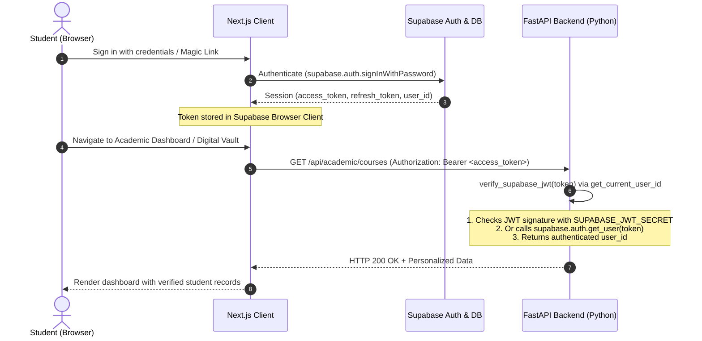

# Supabase Auth & JWT Verification Flow

CampusOS utilizes Supabase Auth for student authentication and session management.

## Authentication Sequence

## Security Guarantees

1. **Row Level Security (RLS)**:
   Every PostgreSQL table enables RLS (`ALTER TABLE ... ENABLE ROW LEVEL SECURITY`). Student records are strictly accessible when `auth.uid() = user_id`.

2. **Private Storage Buckets**:
   Storage bucket `vault-private` restricts access to files prefixed with the student's authenticated user ID.

3. **Backend Authorization Dependency**:
   Protected FastAPI endpoints utilize `user_id: str = Depends(get_current_user_id)`, ensuring unauthenticated requests are rejected with `HTTP 401 Unauthorized`.
